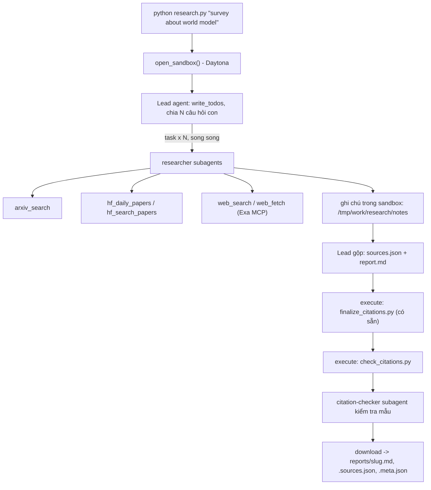

# Deep Research Agent (Deep Agents + Sandbox)

Lab dựng một **hệ thống deep research đa tác tử**: người dùng chỉ cần nhập một chủ đề (ví dụ `survey about world model`), hệ thống tự lập kế hoạch, giao việc cho nhiều subagent, tìm tài liệu trên arXiv, Hugging Face và web, rồi viết một **báo cáo có trích dẫn**.

Hình thức: **bài thực hành cá nhân**. Ngôn ngữ lập trình: Python 3.11 trở lên.

## 1. Mục tiêu học tập

Sau lab, bạn có thể:

1. Dựng agent bằng thư viện Deep Agents (LangChain): công cụ (tool), system prompt, subagent, backend.
2. Dùng **sandbox** (Daytona) làm không gian làm việc và nơi chạy mã cho agent; hiểu vì sao khóa API và công cụ mạng phải nằm ở phía host chứ không nằm trong sandbox.
3. Viết công cụ gọi API ngoài **chịu được giới hạn tốc độ** (retry, backoff, jitter, `Retry-After`).
4. Thiết kế quy trình đa tác tử: lead chia nhỏ câu hỏi, giao cho N researcher chạy song song, tổng hợp và kiểm tra trích dẫn.
5. Tạo báo cáo có thể kiểm chứng: mọi khẳng định có `[n]` trỏ tới một nguồn có thật.

## 2. Hệ thống làm gì



Nguồn dữ liệu:

| Nguồn | Dùng để |
|---|---|
| arXiv API `https://export.arxiv.org/api/query` | Tìm bài theo từ khóa, sắp theo ngày |
| Hugging Face Daily Papers `/api/daily_papers` | Bài đang "trending": upvotes, githubRepo, summary |
| Hugging Face papers search `/api/papers/search?q=` | Tìm bài theo chủ đề |
| Web qua Exa MCP (`web_search_exa`, `web_fetch_exa`) | Blog, survey, trang dự án, nội dung đầy đủ của một URL |

## 3. Cấu trúc thư mục

```
Lab/
├── README.md  GUIDE.md  RUBRIC.md  REPORT_TEMPLATE.md   tài liệu
├── topics.md                 5 chủ đề cần chạy
├── requirements.txt  .env.example  .gitignore
├── model.py                  CÓ SẴN - không sửa: tạo mô hình LLM từ biến môi trường
├── sandbox.py                CÓ SẴN - không sửa: sandbox Daytona (hoặc Docker), upload, download
├── self_check.py             CÓ SẴN - không sửa: tự kiểm tra trước khi nộp (python self_check.py)
├── finalize_citations.py     CÓ SẴN - không sửa: script chạy trong sandbox, tự sinh `## References` và đánh số lại trích dẫn
├── tools.py                  SINH VIÊN CÀI ĐẶT: retry + 5 công cụ nguồn dữ liệu
├── agents.py                 SINH VIÊN CÀI ĐẶT: prompt, subagent, lead agent
├── research.py               SINH VIÊN CÀI ĐẶT: script chính
├── check_citations.py        SINH VIÊN CÀI ĐẶT: kiểm tra trích dẫn, chạy TRONG sandbox
└── reports/                  báo cáo sinh ra (bạn commit vào repo nộp)
```

Bộ khung ban đầu đánh dấu `TODO n` theo `GUIDE.md`. Bản này đã hoàn thiện
`tools.py`, `agents.py`, `research.py` và `check_citations.py`; các test nằm trong `tests/`.

## 4. Cài đặt

```bash
python3 -m venv .venv && source .venv/bin/activate      # Python 3.11+
pip install -r requirements.txt
cp .env.example .env                                     # rồi điền khóa CỦA BẠN
```

Bạn cần ba loại khóa (điền vào `.env`, **không bao giờ commit** `.env`):

| Khóa | Lấy ở đâu | Ghi chú |
|---|---|---|
| LLM (`LAB_MODEL` + khóa nhà cung cấp) | Nhà cung cấp bạn chọn (OpenAI, Anthropic, Google, OpenRouter, Ollama...) | Mô hình **phải hỗ trợ tool calling**. Chép tên mô hình từ tài liệu của nhà cung cấp. |
| `DAYTONA_API_KEY` | https://app.daytona.io | Kiểm tra gói miễn phí / credit hiện hành. Không có tài khoản hoặc hết credit: đặt `SANDBOX=docker` để chạy sandbox trong container Docker cục bộ (xem `.env.example`). |
| `EXA_API_KEY` (khuyến nghị) | https://dashboard.exa.ai/api-keys | Có thể chạy không khóa, nhưng bản miễn phí của MCP bị giới hạn tốc độ rất nhanh. |

## 5. Làm bài

Làm theo thứ tự (chi tiết trong `GUIDE.md`):

1. `check_citations.py`: khởi động nhẹ, thuần Python.
2. `tools.py`: viết `with_retry` và 5 công cụ. Thử riêng từng công cụ: `python tools.py`.
3. `agents.py`: viết prompt, subagent và lead agent.
4. `research.py`: ghép tất cả; chạy một chủ đề:

```bash
python research.py "survey about world model"
```

Kết quả nằm ở `reports/survey-about-world-model.md` cùng `.sources.json` và `.meta.json`.

### Kiểm tra bản cài đặt

Bốn tệp sinh viên đã được cài đặt. Chạy các test offline (không gọi API, không tốn token):

```bash
source .venv/bin/activate
python -m unittest discover -s tests -v
```

Thử công cụ thật bằng `python tools.py`. arXiv có thể trả HTTP 429 và cần chờ retry.
Chạy một chủ đề bằng lệnh bên trên trước khi chạy đủ năm chủ đề. Script kiểm tra
trích dẫn trong sandbox trước khi tải về; chỉ lưu kết quả hợp lệ, có ít nhất ba
nhãn nguồn và ba lần giao việc. Báo cáo và JSON nguồn giữ nguyên byte tải từ sandbox.

Với OpenRouter và Docker, điền cấu hình sau trong `.env` bằng key của bạn:

```dotenv
LAB_BASE_URL=https://openrouter.ai/api/v1
LAB_MODEL=openai/gpt-4o-mini
LAB_API_KEY=<your-openrouter-key>
SANDBOX=docker
SANDBOX_IMAGE=python:3.12-slim
EXA_API_KEY=<your-exa-key>
# Tùy chọn: giới hạn đầu ra mỗi lần gọi model; model trả phí mặc định 2048.
LAB_MAX_TOKENS=2048
```

Không cần `DAYTONA_API_KEY` khi dùng Docker. Nếu OpenRouter trả 402, kiểm tra credit
và hạn mức của key; hạn mức đầu ra thấp hơn không thay thế credit cho toàn bộ lượt
nghiên cứu. `meta.json` chỉ đếm token của lead, không bao gồm token subagent.

Để dùng Gemini trực tiếp, bỏ/comment `LAB_BASE_URL` và `LAB_API_KEY`, rồi đặt
`LAB_MODEL=google_genai:gemini-3.8-flash` và `GOOGLE_API_KEY` trong `.env`.
Thư viện Google đã có trong `requirements.txt`. Chọn model có sẵn cho key của bạn.

### Tiết kiệm quota và tiếp tục khi chạy lỗi

Ngân sách mặc định là **36 lượt gọi model chung cho lead và tất cả subagent trong
mỗi lần chạy**, không phải 36 cho mỗi agent. Có thể đặt `LAB_REQUEST_BUDGET` trong
`.env` hoặc dùng `--request-budget`. Giới hạn này không biết quota tài khoản còn
bao nhiêu và không bảo đảm đủ để hoàn thành báo cáo. Ví dụ chạy với trần 30 lượt:

```bash
python research.py "survey about world model" --request-budget 30
```

Chương trình lưu ghi chú, bản nháp báo cáo/nguồn và thống kê tiến độ vào
`.research-progress/` sau các bước của lead và các lần ghi tệp. Nếu hết quota,
lỗi API hoặc bị Ctrl+C, nó cố tải tiến độ về **trước khi sandbox bị xóa**.
Thư mục này được gitignore và không phải báo cáo nộp bài. Một lỗi lưu tiến độ sẽ
được báo rõ; chỉ dữ liệu đã ghi được trong sandbox mới có thể phục hồi.

Khi quota khả dụng, chạy **cùng chủ đề** để tự nạp tiến độ vào sandbox mới:

```bash
python research.py "survey about world model"
```

Lead kiểm tra và dùng lại ghi chú đủ bằng chứng, chỉ giao phần còn thiếu. Đây là
tiếp tục từ các tệp nghiên cứu, không phải khôi phục nguyên trạng hội thoại/graph;
agent vẫn cần vài lượt để đọc và đánh giá tiến độ. Các ghi chú cũ phải được kiểm
tra vì có thể dở dang. Thống kê lead và số request trong metadata cộng các lần
chạy, không tạo số lượt giả để đạt rubric. Báo cáo chỉ được lưu vào `reports/`
sau khi hoàn thiện và kiểm tra trong sandbox mới; checkpoint được xóa khi thành công.

Muốn bỏ qua tiến độ cũ và nghiên cứu lại, dùng `--fresh`:

```bash
python research.py "survey about world model" --fresh
```

Prompt ưu tiên đúng 3 nhánh ban đầu, mỗi nhánh khoảng 3-4 nguồn, tìm/đọc theo batch,
tránh fetch lặp, và gộp finalizer + validator trong một lệnh. Client không tự retry
lỗi LLM; công cụ dữ liệu vẫn retry lỗi tạm thời. Với OpenRouter Free, cấu hình:

```dotenv
LAB_BASE_URL=https://openrouter.ai/api/v1
LAB_MODEL=openrouter/free
LAB_API_KEY=<your-openrouter-key>
LAB_REQUEST_BUDGET=36
# Mặc định free model là 4096 để giảm nguy cơ cắt mất nội dung ghi chú.
LAB_MAX_TOKENS=4096
```

Các ghi chú của những lần chạy trước khi tính năng lưu tiến độ được cài đặt
không thể phục hồi nếu sandbox đã bị xóa.

Kiểm tra báo cáo đã tạo:

```bash
python check_citations.py reports/survey-about-world-model.md reports/survey-about-world-model.sources.json
python self_check.py
```

## 6. Chủ đề và nộp bài

- Chạy đủ **5 chủ đề** trong [`topics.md`](topics.md), mỗi chủ đề một lần.
- Commit mã nguồn và toàn bộ `reports/`, đẩy lên một **public repo** GitHub và nộp link.
- Kiểm tra trước khi nộp: chạy **`python self_check.py`** (không tốn token): nó kiểm tra đủ 5 báo cáo, `meta.json`, trích dẫn bằng `check_citations.py` của bạn, và không có `.env`/khóa nào trong git.
- Cách chấm: xem [`RUBRIC.md`](RUBRIC.md).

## 7. Thời gian, chi phí và an toàn

- Dùng một mô hình **rẻ nhưng hỗ trợ tool calling**, và **đặt giới hạn** (số lần gọi mô hình/công cụ cho lead và subagent, `recursion_limit`): một prompt hỏng có thể khiến agent lặp rất lâu. Đây là hạng mục 2.5 của `RUBRIC.md`.
- Kết quả có tính ngẫu nhiên: cùng một mã có thể cho báo cáo hợp lệ ở lần này và trích dẫn lỗi ở lần sau. Hãy sửa **prompt và mã**, không sửa tay báo cáo.

- Mỗi lần chạy tốn token LLM và thời gian sandbox. `tokens` trong `meta.json` chỉ đếm tin nhắn của lead, chưa gồm subagent, nên chi phí thật cao hơn. `open_sandbox()` luôn dừng và xóa sandbox khi kết thúc, kể cả khi lỗi. Đừng bỏ qua nó.
- **Không đưa bí mật vào sandbox.** Sandbox không ngăn được prompt injection hay việc đẩy dữ liệu ra mạng; một trang web độc hại có thể khiến agent chạy lệnh bên trong sandbox. Vì vậy mọi công cụ gọi mạng và mọi khóa ở lại phía host.
- Nội dung lấy từ web là **dữ liệu không đáng tin**: agent không được làm theo chỉ dẫn nằm trong đó.
